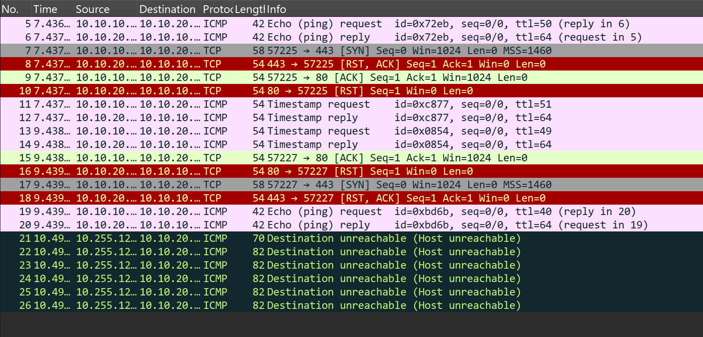

# Johdanto

Tietoturva verkonhallinnan näkökulmasta.

# Kaappaus

Keräsimme verkkoliikenteen tcpdump työkalulla jolla kirjoitimme eth1 verkkoliitännän verkkoliikenteen web1.pcap nimiseen tiedostoon.

# Porttiskannaus

skannaus tuli IP-osoitteesta 10.10.10.200. - aa:c1:ab:ff:7d:d9

# Wireshark

Havaintoja liikenteestä.

skannaus tuli IP-osoitteesta 10.10.10.200. - aa:c1:ab:ff:7d:d9
Testattuja portteja: mm. 443, 995, 25, 8080, 1025, 8888, 111, 113, 23, 5900, 22, 53, 554
Palvelin: 

Ei DNS liikennettä.
Ei HTTP liikennettä.

# Loki-analyysi

Tutkitut lokit ja löydökset.

# Turvallisuusarvio

Parannusehdotukset.

# Yhteenveto

Opitut asiat.
