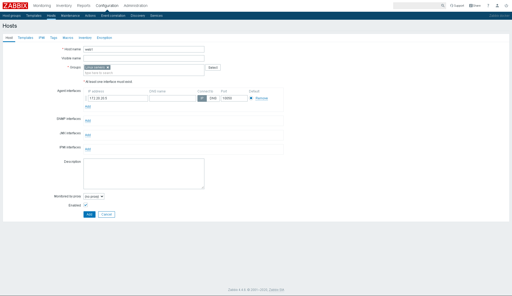
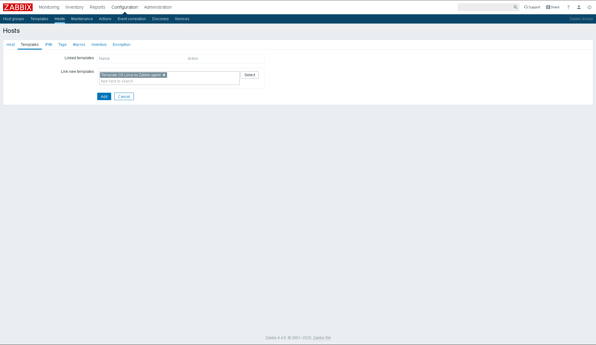
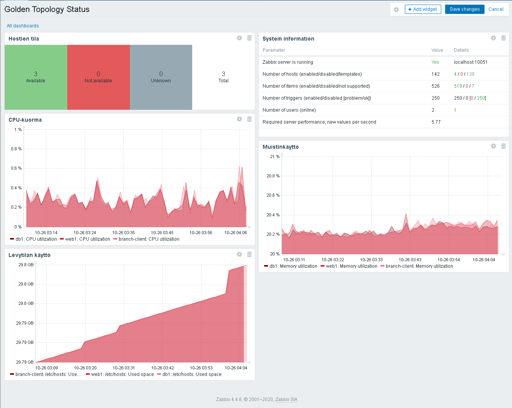
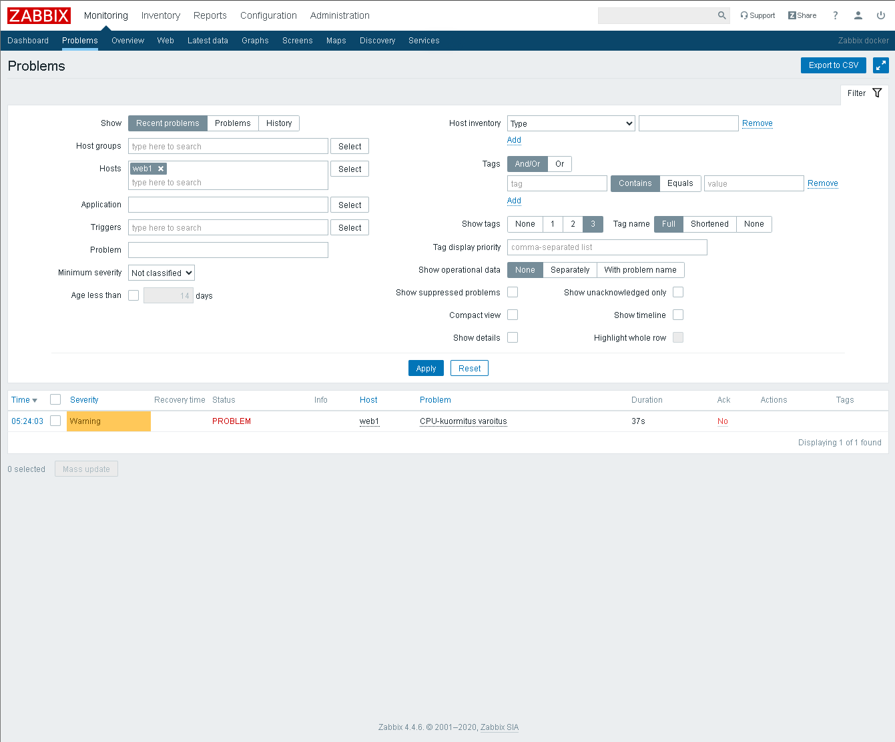

# 1. Johdanto

Zabbix on monitorointi ja hallinta palvelu, jota voidaan käyttää suuremmissakin mittakaavoissa.

Hosts: Näkymä, jossa hallitaan Zabbixiin liitettyjä laitteita.

Templates: Pohjat, jotka sisältävät sääntöjä ja asetuksia, joita voidaan liisätä laitteisiin.

Monitoring: Näkymä, jossa näkyy järjestelmän tilan, kerätyt tiedot, ongelmat.

Dashboards: Ovat näyttöjä, joihin kootaan haluttua dataa.

Alerts: Hälytyksiä lähetetään esimerkiksi silloin kun jokin trigger aktivoituu.

Reports: Raporttit kertovat, miten kaikki toimii tai miten ne eivät toimi.

# 2. Hostien lisääminen
web1
```bash
apt update
apt install nano -y
wget https://repo.zabbix.com/zabbix/7.4/release/ubuntu/pool/main/z/zabbix-release/zabbix-release_latest_7.4+ubuntu24.04_all.deb
dpkg -i zabbix-release_latest_7.4+ubuntu24.04_all.deb
apt update
apt install zabbix-agent -y
nano /etc/zabbix/zabbix_agentd.conf
```
zabbix_agentd.conf
```
PidFile=/run/zabbix/zabbix_agentd.pid
LogFile=/var/log/zabbix/zabbix_agentd.log
LogFileSize=0
Server=172.20.20.16
ServerActive=172.20.20.16
Hostname=web1
```
web1
```bash
service zabbix-agent restart
```
db1 ja branch-client määrittelyt ovat muuten identtiset paitsi, että hostname tietysti vaihdetaan.

Zabbixin puolella lisätään web1:


db1 ja branch-client on sama mutoin paitsi IP:n ja nimen osilta.

# 3. Dashboard

Kuvakaappaus dashboardista.
Kurssin tärkeimmät opit.

# 4. Mittarit


| Mittari | Arvo | Merkitys |
|----------|----------|----------|
|CPU utilization|0.7074 % |Suorittimen käyttöaste kertoo kuinka kuormittunut palvelin on juuri nyt ja sitä kannattaa seurata, sillä se kertoo kun palvelimen suoritus teho on liian alhainen, joko koska sen kuorma on liian raskas tai koska se on jumiutunut. juuri nyt käyttö on lähes mitätöntä. |
|Memory utilization|20.192 % |kertoo kuinka paljon muistia on käytössä jota kannattaa seurata sillä jos se loppuu niin tulee ongelmia. juuri nyt ei ole panikointiin aihetta. |
|Load average (15m avg) |0.0898 |kertoo kuinka kuormittunut palvelin on joka kertoo josko palvelimen kuorma on mitoitettu oikein palvelimen suoritus tehoon nähden. juuri nyt näyttää hyvältä. |
|System uptime |1 day, 17:12:40 | kertoo kuinka kauan laite on ollut päällä. jos palvelin on ollut toiminnassa sammumatta pitkään se kertoo palvelimen vakaudessta. nyt on kohta 2 päivää täys. |
|sdd: Disk utilization|2.7569 % |levynkäyttöä kannattaa seurata sillä jos levyn käyttö on korkea niin se saattaa viitata siihen ettei levy pysty täyttämään palvelimen tarpeita. ei näytä ongelmalliselta just ny.|


# 5. Triggerit

Triggeri 1
- CPU-kuormitus varoitus
- warning
- {web1:system.cpu.util.last()}>80

Triggeri 2
- Tallennustila varoitus
- warning
- {web1:vfs.fs.size[/etc/hostname,pused].last()}>80

# 6. Hälytys- ja häiriötestit
```bash
yes > /dev/null
```

apachen sulkemiseen ei reagoida ollenkaan sillä emme monitoroi apachen tilaa

# 7. Vertailu

|Ominaisuus|SNMP|Prometheus|Zabbix|
|------------|------|------------|--------|
|Tiedonkeruu|Pull-malli. Käyttää valmiita MIB-puita.|Pull-malli luulisin. |Sekä Pull että Push-malli. Oma agentti, SNMP, skriptit ja API-tuki.|
|Dashboardit|EI!|on.|On!|
|Hälytykset|SNMP Trap -viestit.|Alertmanager koodipohjainen sääntöjen määrittely.|Monipuoliset ehdot, skenaariot ja valmiit viestikanavat.|
|Käyttöönotto|OID-osoitteiden hallinta on työlästä.|Konfiguroidaan YAML-tiedostoilla.| Vaatii relaatiotietokannan ja palvelimen.|
|Skaalautuvuus|Rajoittunut.|Suunniteltu pilvi- ja mikropalveluympäristöihin.|Skaalautunee.|
|Yrityskäyttö|On usein verkkolaitteille.|Standardi modernissa pilvessä kontteineen.|Suosittu perinteisessä IT-infrassa, konesaleissa ja palvelinvalvonnassa.|

# 8. Yhteenveto
keskitetty valvonta helpottaa laitteiden valvontaa ja mahdollistaa proaktiivisen ylläpidon, jolloin ongelmat voidaan korjata ennen kuin ne tulevat ongelmiksi.
tärkeimmät mittarit ei missään järjestyksessä ovat latenssi, verkkoliikenne, virheet, resurssien käyttöaste.
ylläpitäjän tulisi saada hälytys aina silloin kun järjestelmässä tapahtuu jotain joka vaatii jotain pikaista toimenpidettä.
Prometheuksen paras käyttö kohde on mikropalvelut, kubernetes, dynaamiset pilviympäristöt.
Zabbix toimii parhaiten fyysisten palvelimien ja verkkolaitteiden kanssa.
lisäisin ympäristöön poikkeamahälytykset.


Kurssilla käytimme kaiken laisia ohjelmistoja SNMP, Prometheus, Zabbix, Wireshark, yms.

